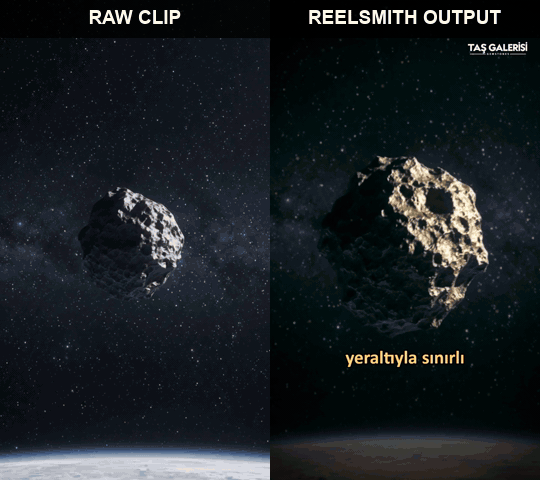
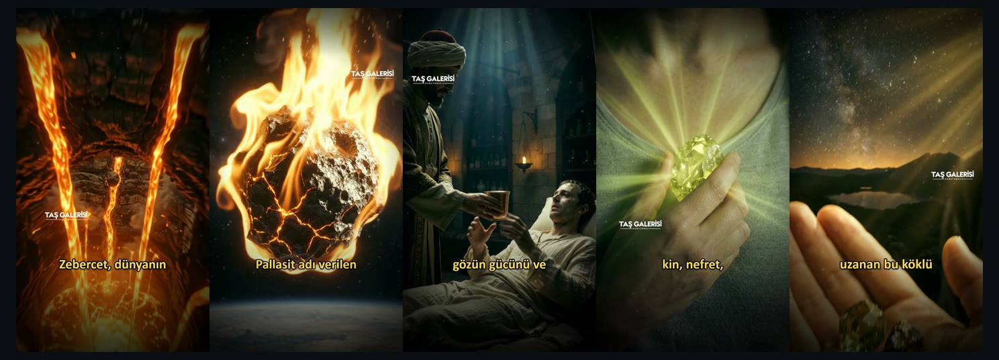

<div align="center">




<a href="#quick-start"></a>
<a href="#quick-start"></a>


<a href="LICENSE"></a>
<br/>
<a href="https://github.com/EmirhanYAZICI/reelsmith/actions/workflows/ci.yml"></a>

An agent skill that turns a folder of raw material into a finished, Instagram-ready vertical Reel.<br/>
Bir klasördeki ham malzemeden Instagram'a hazır dikey Reels videosu üreten ajan skill'i.

[Demo](#demo) · [Quick start](#quick-start) · [English](#english) · [Türkçe](#türkçe) · [Hızlı başlangıç](#hızlı-başlangıç)

</div>

---

## Demo

A real project made with Reelsmith: a 7-scene, 2:22 Reel about the gemstone "Zebercet" (peridot) for Taş Galerisi.<br/>
Reelsmith ile yapılmış gerçek bir proje: Taş Galerisi için "Zebercet" taşı hakkında 7 sahneli, 2:22'lik bir Reels.

<div align="center">





**[Watch the full Reel (2:22, 48 MB) / Videonun tamamını izle](https://github.com/EmirhanYAZICI/reelsmith/releases/download/v1.3.0/reelsmith-demo-zebercet.mp4)**

</div>

| | Input / Girdi | Output / Çıktı |
|---|---|---|
| Video | 7 clips, 10 s each, 720x1280, no captions / 7 klip, 10'ar sn, altyazısız | 2:22, 1080x1920, 30 fps, H.264 + AAC |
| Audio | 2:22 voiceover + the clips' own sound / seslendirme + kliplerin sesi | -14 LUFS, peak -0.9 dBFS, clip sound ducked under speech |
| Text | Scene script, 239 words / sahne metni, 239 kelime | 97 word-timed caption blocks / kelime zamanlı altyazı bloğu |
| Brand | `logo.png` | Moving watermark, corner to corner / köşeden köşeye kayan logo |

Time: about 15-25 minutes for a 2-3 minute Reel on a mid-range laptop (tested on Intel i5-13420H, 16 GB RAM), mostly clip slow-motion and the render. Whisper and alignment take under a minute.

---

## Quick start

**1. Install everything with one command.** It sets up the tools and copies the skills into every agent it finds on your machine.

```powershell
# Windows (PowerShell)
& ([scriptblock]::Create((irm https://raw.githubusercontent.com/EmirhanYAZICI/reelsmith/main/install.ps1)))
```

```bash
# macOS / Linux / Git Bash
curl -fsSL https://raw.githubusercontent.com/EmirhanYAZICI/reelsmith/main/install.sh | bash
```

Prefer to read the script before it runs, or want a fixed version? Download the release, check its SHA-256, read `install.ps1` / `install.sh`, then run it from the folder (it uses the downloaded files and clones nothing):

```powershell
# Windows (PowerShell)
irm https://github.com/EmirhanYAZICI/reelsmith/releases/download/v1.3.1/reelsmith-v1.3.1.zip -OutFile reelsmith-v1.3.1.zip
irm https://github.com/EmirhanYAZICI/reelsmith/releases/download/v1.3.1/SHA256SUMS.txt -OutFile SHA256SUMS.txt
(Get-FileHash reelsmith-v1.3.1.zip -Algorithm SHA256).Hash   # must match the line in SHA256SUMS.txt
Expand-Archive reelsmith-v1.3.1.zip .; notepad reelsmith\install.ps1
powershell -ExecutionPolicy Bypass -File reelsmith\install.ps1
```

```bash
# macOS / Linux / Git Bash
curl -fsSLO https://github.com/EmirhanYAZICI/reelsmith/releases/download/v1.3.1/reelsmith-v1.3.1.zip -fsSLO https://github.com/EmirhanYAZICI/reelsmith/releases/download/v1.3.1/SHA256SUMS.txt
sha256sum -c SHA256SUMS.txt --ignore-missing      # macOS: shasum -a 256 -c SHA256SUMS.txt --ignore-missing
unzip -q reelsmith-v1.3.1.zip && less reelsmith/install.sh
./reelsmith/install.sh
```

The installer never deletes your edits: if an installed `reelsmith` or `whisper-tr` folder differs from the new one, it is moved to `~/.reelsmith-backups/<time>/` first. It requires Python 3.10-3.12 and stops with a clear message otherwise.

**2. Or install for one agent only.**

| Agent | Install | Then |
|---|---|---|
| **Claude Code** | `/plugin marketplace add EmirhanYAZICI/reelsmith`<br/>`/plugin install reelsmith@reelsmith` | Type `/reelsmith my-brand` |
| **OpenAI Codex CLI** | installer with `-Agents codex` / `--agents=codex` | Ask: *use the reelsmith skill on my-brand* |
| **Cursor** | installer with `-Agents cursor` / `--agents=cursor` | Ask in Agent chat: *use the reelsmith skill on my-brand* |
| **OpenCode** | installer with `-Agents opencode` / `--agents=opencode` | Ask: *use the reelsmith skill on my-brand* |
| **Google Antigravity** | installer with `-Agents antigravity` / `--agents=antigravity` | Ask: *use the reelsmith skill on my-brand* |
| **Any other agent** | `npx skills add EmirhanYAZICI/reelsmith` | It reads [`AGENTS.md`](AGENTS.md) if it has no skill support |

For one agent with the installer: `.\install.ps1 -Agents codex` or `./install.sh --agents=codex` (from a clone of this repo).

**3. Prepare your material.** Reelsmith edits your clips; it does not generate them. Make them first:

1. **Write the script, scene by scene.** Split the narration into scenes (5-10 is typical). Each scene's text is exactly what the voiceover says during that scene.
2. **Generate one clip per scene, in order,** with any video tool: Google Gemini (Veo), Kling, Runway, Sora, or your own footage. Vertical 9:16, about 8-10 seconds each. Write each prompt from that scene's text. The clips can keep their own music and sound effects; Reelsmith keeps them and lowers them under the voice.
3. **Name the clips by scene number:** `scene1.mp4`, `scene2.mp4`, ... (or `1sahne.mp4`). The number decides which scene a clip belongs to. Two clips for one scene: `scene3.mp4` and `scene3_b.mp4`.
4. **Record or generate the voiceover** reading the script, in the same order.
5. **Add your logo** as a transparent `logo.png`.

Example script (`script.txt`), one paragraph per scene:

```
This green stone comes from deep inside the Earth.

Volcanoes carry its crystals up to the surface.

Some of it even fell from space, inside meteorites.
```

**4. Make a Reel.** Put your files in a folder on the Desktop and call the skill:

```
my-brand/
├── voiceover.mp3      the narration
├── scene1.mp4         scene 1 clip   (scene2.mp4, scene3.mp4 ...)
├── script.txt         the text of each scene
└── logo.png           your logo, used as the moving watermark
```

```
/reelsmith my-brand reel.mp4 white text, box style, word by word
```

Before anything slow starts, the agent runs a preflight check and tells you what is missing or broken (a missing scene number, a corrupt clip, no logo, a missing tool). You can run it yourself too:

```bash
python skills/reelsmith/template/scripts/check.py --src=~/Desktop/my-brand
```

The finished `reel.mp4` is saved in `my-brand/` and in a `cikti/` folder next to it. No API keys are needed. Everything runs on your machine.

## Hızlı başlangıç

**1. Her şeyi tek komutla kur.** Gerekli araçları hazırlar ve skill'leri bilgisayarında bulduğu her ajana kopyalar.

```powershell
# Windows (PowerShell)
& ([scriptblock]::Create((irm https://raw.githubusercontent.com/EmirhanYAZICI/reelsmith/main/install.ps1)))
```

```bash
# macOS / Linux / Git Bash
curl -fsSL https://raw.githubusercontent.com/EmirhanYAZICI/reelsmith/main/install.sh | bash
```

Script'i çalışmadan önce okumak ya da sabit bir sürüm kurmak istersen: Release'i indir, SHA-256 değerini kontrol et, `install.ps1` / `install.sh` dosyasını oku, sonra klasörden çalıştır (indirilen dosyaları kullanır, başka bir şey indirmez). Komutlar yukarıdaki İngilizce bölümde aynı.

Kurulum aracı senin değişikliklerini silmez: kurulu `reelsmith` ya da `whisper-tr` klasörü yenisinden farklıysa önce `~/.reelsmith-backups/<zaman>/` içine taşınır. Python 3.10-3.12 ister, başka sürümde açık bir mesajla durur.

**2. Ya da sadece tek bir ajana kur.**

| Ajan | Kurulum | Sonra |
|---|---|---|
| **Claude Code** | `/plugin marketplace add EmirhanYAZICI/reelsmith`<br/>`/plugin install reelsmith@reelsmith` | `/reelsmith markam` yaz |
| **OpenAI Codex CLI** | kurulum aracı `-Agents codex` / `--agents=codex` | Yaz: *markam klasöründe reelsmith skill'ini kullan* |
| **Cursor** | kurulum aracı `-Agents cursor` / `--agents=cursor` | Agent sohbetinde yaz: *markam klasöründe reelsmith skill'ini kullan* |
| **OpenCode** | kurulum aracı `-Agents opencode` / `--agents=opencode` | Yaz: *markam klasöründe reelsmith skill'ini kullan* |
| **Google Antigravity** | kurulum aracı `-Agents antigravity` / `--agents=antigravity` | Yaz: *markam klasöründe reelsmith skill'ini kullan* |
| **Diğer ajanlar** | `npx skills add EmirhanYAZICI/reelsmith` | Skill desteği yoksa [`AGENTS.md`](AGENTS.md) dosyasını okur |

**3. Malzemeyi hazırla.** Reelsmith kliplerini kurgular, klip üretmez. Önce onları hazırla:

1. **Metni sahne sahne yaz.** Anlatımı sahnelere böl (genelde 5-10 sahne). Her sahnenin metni, o sahnede seslendirmede okunan yazının aynısı olsun.
2. **Her sahne için sırayla bir video üret:** Google Gemini (Veo), Kling, Runway, Sora ya da kendi çekimin. Dikey 9:16, her biri 8-10 saniye. Her videonun komutunu (prompt) o sahnenin metnine göre yaz. Videoların kendi müziği ve efekti olabilir; Reelsmith onları korur ve konuşma sırasında kısar.
3. **Videoları sahne numarasıyla adlandır:** `1sahne.mp4`, `2sahne.mp4`, ... (ya da `scene1.mp4`). Hangi videonun hangi sahneye gideceğini numara belirler. Bir sahneye iki video: `3sahne.mp4` ve `3sahne_b.mp4`.
4. **Seslendirmeyi** aynı sırayla metni okuyarak kaydet ya da ürettir.
5. **Logonu** şeffaf `logo.png` olarak ekle.

Örnek sahne metni (`metin.txt`), her sahne bir paragraf:

```
Bu yeşil taş Dünya'nın derinliklerinden gelir.

Volkanlar kristallerini yeryüzüne taşır.

Bir kısmı ise göktaşlarının içinde uzaydan düşmüştür.
```

**4. Reels'i yap.** Dosyaları Masaüstünde bir klasöre koy ve skill'i çağır:

```
markam/
├── seslendirme.mp3    anlatım sesi
├── scene1.mp4         1. sahne videosu   (scene2.mp4 ... ya da 1sahne.mp4)
├── metin.txt          her sahnenin metni
└── logo.png           logon, video boyunca köşeden köşeye gezer
```

```
/reelsmith markam reels.mp4 beyaz yazı, kutulu, kelime kelime hoplasın
```

Uzun işler başlamadan önce ajan bir ön kontrol çalıştırır ve eksik ya da bozuk olanı söyler (eksik sahne numarası, bozuk klip, logo yok, eksik araç). İstersen kendin de çalıştırabilirsin:

```bash
python skills/reelsmith/template/scripts/check.py --src=~/Desktop/markam
```

Bitmiş `reels.mp4` hem `markam/` içine hem de yanındaki `cikti/` klasörüne kaydedilir. API anahtarı gerekmez. Her şey senin bilgisayarında çalışır.

---

## English

### What it does

You put a voiceover, numbered scene clips, a scene script and your logo in a folder. Then you ask your agent:

```
/reelsmith my-folder my_reel.mp4
```

The skill then does the following:

1. **Transcribes the voiceover locally with Whisper** (faster-whisper, Turkish by default). It produces word-level timestamps and needs no API key and no paid service.
2. **Aligns the transcript to your script.** Captions use your spelling, not Whisper's guesses. Scene boundaries come from when each scene's text is actually spoken.
3. **Fits every clip to its scene.**
   - Each ~10 s clip is slowed down to match the length of its narration.
   - Motion-compensated frame interpolation (ffmpeg `minterpolate`) keeps the slowdown smooth.
   - Clips are cropped to 9:16 and lightly color-graded.
4. **Builds the edit with HyperFrames (HTML + GSAP):**
   - crossfade transitions with a light leak
   - one slow, continuous camera move per scene (no sudden zooms)
   - film grain and dust overlay
   - word-timed captions, 2-3 words per block
5. **Adds a moving logo watermark.** Your logo glides slowly from corner to corner for the whole video, which makes the Reel hard to crop and re-upload. It is kept exactly as uploaded: full opacity, no effects.
6. **Mixes the audio:**
   - The voiceover is normalized to -14 LUFS.
   - The clips keep their own music and sound effects, ducked by 9 dB while someone speaks.
   - A soft whoosh plays on scene changes.
   - A limiter caps peaks at about -1 dBFS.
7. **Renders and checks the result:** 1080x1920, 30 fps, H.264 High + AAC, `faststart`. The skill verifies resolution, loudness and frozen frames, then copies the video next to your source files.

It works for any brand. The logo you drop in the folder is the brand.

### Captions: fixed placement, flexible look

Captions always sit in the same place: Calibri Bold 75 px, 450 px from the bottom, centered. Only three things change:

| Option | Default | Values |
|---|---|---|
| `--caption-color` | `yellow` | `yellow`, `white`, `green`, `gold`, `orange`, `red`, `pink`, `blue`, `purple`, `black`, or any `#RRGGBB` |
| `--caption-outline` | `#000000` | same list (outline / shadow color) |
| `--caption-style` | `outline` | `outline`, `box`, `shadow`, `double` |
| `--caption-anim` | `pop` | `pop`, `hop`, `word-hop` (each word jumps in exactly when it is spoken), `bounce`, `wave` |

Through an agent, you can describe the captions in plain words, for example: `/reelsmith my-folder white text, boxed, words hop in one by one`.
See [`CAPTION-STYLES.md`](skills/reelsmith/CAPTION-STYLES.md) for the full list and ready-made presets.

### Logo: moving, fixed or intro/outro

| Option | Default | Values |
|---|---|---|
| `--logo-mode` | `move` | `move` (glides corner to corner, hard to crop out), `corner` (stays in one corner), `ends` (large and centered at the start and the end). `ends` combines with the others: `move,ends`, `corner,ends` |
| `--logo-pos` | `bottom-left` | `bottom-left`, `bottom-right`, `top-left`, `top-right` (start corner for `move`, the corner for `corner`) |
| `--logo-size` | `258` | width in px, 80-700 |
| `--logo-moves` | `6` | how many corner-to-corner moves over the whole video (fewer = slower) |

The logo is always used as uploaded: original colors, full opacity, no effects. You can say it in words too: `/reelsmith my-folder logo fixed top right, also big at the start and end`.

### Requirements

| Tool | Notes |
|---|---|
| An agent with a local shell | Claude Code, Cursor, Codex CLI, OpenCode, Antigravity... Web chat apps without a local shell cannot run it |
| [OpenMontage](https://github.com/calesthio/OpenMontage) | Workspace and Python 3.12 virtual environment |
| Python packages | `faster-whisper`, `numpy` (see `requirements.txt`) |
| Node.js + [HyperFrames](https://www.npmjs.com/package/hyperframes) | `npm i -g hyperframes@0.8` (tested with 0.8.x) |
| ffmpeg / ffprobe | Must be on `PATH` |
| Calibri Bold font | Ships with Windows (`C:\Windows\Fonts\calibrib.ttf`). It is **not** included here for licensing reasons. On other systems pass `--font=<path>` |

No API keys are needed. Everything runs locally.

### Install

**Installer (recommended)**

The one-command installer in [Quick start](#quick-start) checks the tools, gets OpenMontage, creates its Python 3.12 environment, installs `faster-whisper`, HyperFrames and its skills, and copies the skills into every agent it finds (Claude Code, Codex, OpenCode, Cursor, Antigravity).

From a clone: `.\install.ps1` or `./install.sh`. Options:

| PowerShell | Bash | Effect |
|---|---|---|
| `-Agents claude,cursor` | `--agents=claude,cursor` | Pick agents (`auto` = found on this machine, `all`) |
| `-Project` | `--project` | Install into the current project folder instead of your home |
| `-OM <path>` | `--om=<path>` | OpenMontage location |
| `-SkillsOnly` | `--skills-only` | Copy the skills only, skip dependencies |
| `-NoBackup` | `--no-backup` | Replace changed skill folders without keeping a backup |
| `-DryRun` | `--dry-run` | Show what would happen, change nothing |

The installer does not install system tools for you. If `git`, `node`, `ffmpeg` or Python 3.10-3.12 is missing, it stops and prints the command (`winget`, `brew`, `apt`). It checks the real version of the Python it would use (and of an existing `.venv`), not just the command name. It only touches the `reelsmith` and `whisper-tr` folders in each skills folder: identical copies are left alone, changed ones are backed up first.

The manual steps below do the same thing by hand.

**1. Shared dependencies (once)**

```bash
OM=~/Projects/OpenMontage                      # wherever OpenMontage lives
$OM/.venv/Scripts/python.exe -m pip install faster-whisper numpy   # Linux/macOS: $OM/.venv/bin/python
npm i -g hyperframes@0.8
npx hyperframes skills                         # official HyperFrames skills for your agents
```

If OpenMontage is not in `~/Projects/OpenMontage`, set the `OPENMONTAGE_DIR` environment variable to its path.

**2. The skills: pick your tool**

| Tool | Install |
|---|---|
| Claude Code (plugin) | `/plugin marketplace add EmirhanYAZICI/reelsmith`, then `/plugin install reelsmith@reelsmith` |
| Any supported agent | `npx skills add EmirhanYAZICI/reelsmith` (the open [skills](https://skills.sh) CLI; it asks which agents to install for) |
| Manual | Copy `skills/reelsmith` and `skills/whisper-tr` into your tool's skills folder (table below) |

| Tool | Skills folder (user-wide / per project) |
|---|---|
| Claude Code | `~/.claude/skills/` / `.claude/skills/` |
| OpenAI Codex | `~/.codex/skills/` / `.codex/skills/` |
| OpenCode | `~/.config/opencode/skills/` / `.opencode/skills/` |
| Cursor | `~/.cursor/skills/` / `.cursor/skills/` |
| Google Antigravity | `~/.gemini/antigravity/skills/` / `.agent/skills/` |

Folder names can change between tool versions. If a path does not work, check your tool's docs or use `npx skills add`.
Tools that do not load skills still read [`AGENTS.md`](AGENTS.md), which points them to the right `SKILL.md`.

To check the install in Claude Code, type `/`. You should see `reelsmith` and `whisper-tr`.

### Usage

1. Create a folder and put these files in it:

   | File | Rule |
   |---|---|
   | Voiceover | Name contains `seslendirme`, `voice` or `vo` (`.mp3`, `.wav`, `.m4a`) |
   | Scene clips | `scene1.mp4`, `scene2.mp4`, ... (Turkish `1sahne.mp4` also works) vertical, about 10 s each. Their own audio is kept |
   | Scene script | `.txt` or `.md` with exactly the text spoken in each scene: one paragraph per scene (blank line between), or one `Text: "..."` line per scene, or the original `Metin karşılığı: "...")` lines |
   | Logo | `logo.png`, transparent background |
   | Optional | `REELS-REHBERI.md` with project-specific rules. It overrides the bundled guide |

   You can use any number of scenes. The number of clips must match the number of script entries.
2. Ask your agent:
   ```
   /reelsmith <folder name or path> <output_name>.mp4 [caption wishes]
   ```
3. Clip preparation and rendering take about 15-25 minutes. The finished video is copied into your folder and into a `cikti/` folder next to it.

To run it by hand without an agent, see step 3 in [`skills/reelsmith/SKILL.md`](skills/reelsmith/SKILL.md).

### Supported and not supported

| Supported | Not supported (yet) |
|---|---|
| Vertical 1080x1920 at 30 fps | Other sizes or frame rates (16:9, 1:1, 60 fps) |
| Any number of scenes, one or more clips per scene | Cutting clips on music beats (clips are fitted to the narration) |
| Turkish voiceover (Whisper `language="tr"`); other languages by changing one argument | Automatic translation or voice generation |
| Windows (tested end to end); macOS and Linux run the installer and tests in CI | Rendering without Node.js / Chromium |
| Agents with a local shell | ChatGPT or Claude web chat (no local shell) |

The tested project is 2:22 long. Longer videos work the same way but take proportionally longer, mostly in clip slow-motion and the render.

### Development and tests

```bash
pip install -r requirements-dev.txt
python -m pytest tests
```

The tests cover scene file names, script parsing, caption and logo options, Whisper-to-script alignment (misheard and missing words), the preflight check with real generated media, a full build without the final render (clip slow-motion, 1080x1920 crop, composition data, audio mix) and the output check (`verify.py`: size, frame rate, codecs, loudness, peak, frozen picture, faststart). If HyperFrames is installed, the generated composition is also linted. CI runs them on Windows and Ubuntu and installs the skills with both installers on Windows, macOS and Ubuntu.

What was tested where, installer scenarios, the end-to-end render and what is not covered yet: [`TESTING.md`](TESTING.md).

Found a bug? Open an [issue](https://github.com/EmirhanYAZICI/reelsmith/issues/new/choose) and paste the preflight output.

### Repository layout

| Path | Purpose |
|---|---|
| `skills/reelsmith/SKILL.md` | The steps the agent follows |
| `skills/reelsmith/REELS-REHBERI.md` | Every setting: captions, logo, camera, audio, format, troubleshooting (Turkish) |
| `skills/reelsmith/CAPTION-STYLES.md` | Caption colors, styles, animations and presets (English / Turkish) |
| `skills/reelsmith/template/` | Python scripts and the HyperFrames template copied into each project |
| `skills/whisper-tr/` | Companion skill: local Whisper transcription with word timestamps |
| `.claude-plugin/` | Claude Code plugin and marketplace manifests |
| `AGENTS.md` | Pointer for agents that read `AGENTS.md` instead of skills |
| `install.ps1`, `install.sh` | One-command installer (Windows / macOS, Linux, Git Bash) |
| `skills/reelsmith/template/scripts/check.py` | Preflight check: tools, clips, voiceover, logo, script |
| `skills/reelsmith/template/scripts/verify.py` | Output check after render: size, fps, codecs, loudness, peak, freezes, faststart |
| `tests/`, `TESTING.md` | pytest suite and the test report |
| `assets/` | Banner, social preview image and demo images |

### Origin

The skill was built and tested on a real project, a 7-scene, 2:22 Reel about the gemstone "Zebercet" (peridot) for Taş Galerisi.

---

## Türkçe

### Ne yapar

Bir klasöre seslendirme, numaralı sahne videoları, sahne metni ve logonu koyarsın. Sonra ajanına şunu yazarsın:

```
/reelsmith klasorum videom.mp4
```

Skill şunları yapar:

1. **Seslendirmeyi yerel Whisper ile yazıya döker** (faster-whisper, varsayılan Türkçe). Kelime kelime zaman çıkarır. API anahtarı ya da ücretli servis gerekmez.
2. **Dökümü senin metninle hizalar.** Altyazı Whisper'ın yazımıyla değil, senin yazımınla çıkar. Sahne sınırları her sahnenin metninin gerçekten okunduğu ana göre belirlenir.
3. **Her klibi kendi sahnesine uydurur.**
   - ~10 sn'lik her klip, o sahnenin konuşma süresine kadar yavaşlatılır.
   - Hareket telafili kare ara-değerleme (ffmpeg `minterpolate`) sayesinde takılma olmaz.
   - Klipler 9:16'ya kırpılır ve hafif renk düzeltmesi yapılır.
4. **Kurguyu HyperFrames (HTML + GSAP) ile kurar:**
   - ışık süzmeli crossfade geçişler
   - her sahnede tek, yavaş, kesintisiz kamera hareketi (ani zoom yok)
   - film greni ve toz katmanı
   - kelime zamanlı altyazı, blok başına 2-3 kelime
5. **Hareketli logo filigranı ekler.** Logon video boyunca köşeden köşeye yavaşça kayar. Bu sayede video kırpılıp başkası tarafından yüklenemez. Logo yüklendiği gibi kalır: tam opak, efektsiz.
6. **Sesi miksler:**
   - Seslendirme -14 LUFS'a ayarlanır.
   - Kliplerin kendi müziği ve efekti kalır, konuşma sırasında 9 dB kısılır.
   - Sahne geçişlerinde hafif bir whoosh duyulur.
   - Limiter tepeleri yaklaşık -1 dBFS'de tutar.
7. **Render alır ve sonucu kontrol eder:** 1080x1920, 30 fps, H.264 High + AAC, `faststart`. Skill çözünürlüğü, ses seviyesini ve donan kareleri kontrol eder, sonra videoyu kaynak dosyalarının yanına kopyalar.

Her firma için çalışır. Klasöre koyduğun logo, markadır.

### Altyazı: yeri sabit, görünüşü seçilebilir

Altyazı hep aynı yerdedir: Calibri Bold 75 px, alttan 450 px, ortalı. Sadece üç şey değişir:

| Seçenek | Varsayılan | Değerler |
|---|---|---|
| `--caption-color` | `yellow` | `yellow`, `white`, `green`, `gold`, `orange`, `red`, `pink`, `blue`, `purple`, `black` ya da herhangi bir `#RRGGBB`. Türkçe adlar da olur (`sari`, `beyaz`...) |
| `--caption-outline` | `#000000` | aynı liste (kontur / gölge rengi) |
| `--caption-style` | `outline` | `outline` (kontur), `box` (kutulu), `shadow` (gölgeli), `double` (çift kontur) |
| `--caption-anim` | `pop` | `pop`, `hop`, `word-hop` (her kelime söylendiği anda zıplar), `bounce`, `wave` |

Ajana cümleyle de söyleyebilirsin, örneğin: `/reelsmith klasorum beyaz yazı, kutulu, kelime kelime hoplasın`.
Tüm liste ve hazır kombinasyonlar: [`CAPTION-STYLES.md`](skills/reelsmith/CAPTION-STYLES.md).

### Logo: hareketli, sabit ya da açılış/kapanış

| Seçenek | Varsayılan | Değerler |
|---|---|---|
| `--logo-mode` | `move` | `move` (köşeden köşeye kayar, kesip atmak zor), `corner` (tek köşede sabit), `ends` (açılışta ve kapanışta ortada büyük). `ends` diğerleriyle birleşir: `move,ends`, `corner,ends` |
| `--logo-pos` | `bottom-left` | `bottom-left`, `bottom-right`, `top-left`, `top-right` (`move` için başlangıç köşesi, `corner` için durduğu köşe) |
| `--logo-size` | `258` | px cinsinden genişlik, 80-700 |
| `--logo-moves` | `6` | video boyunca kaç kez köşe değiştirir (az = daha yavaş) |

Logo hep yüklendiği gibi kullanılır: kendi rengi, tam opak, efektsiz. Cümleyle de söyleyebilirsin: `/reelsmith klasorum logo sağ üstte sabit dursun, başta ve sonda da büyük çıksın`.

### Gereksinimler

| Araç | Not |
|---|---|
| Yerel terminali olan bir ajan | Claude Code, Cursor, Codex CLI, OpenCode, Antigravity... Yerel terminali olmayan web sohbet uygulamaları bunu çalıştıramaz |
| [OpenMontage](https://github.com/calesthio/OpenMontage) | Çalışma alanı ve Python 3.12 sanal ortamı |
| Python paketleri | `faster-whisper`, `numpy` (bkz. `requirements.txt`) |
| Node.js + [HyperFrames](https://www.npmjs.com/package/hyperframes) | `npm i -g hyperframes@0.8` (0.8.x ile test edildi) |
| ffmpeg / ffprobe | `PATH`'te olmalı |
| Calibri Bold | Windows'ta hazır gelir (`C:\Windows\Fonts\calibrib.ttf`). Lisans gereği bu repoda **yok**. Başka sistemde `--font=<yol>` ver |

API anahtarı gerekmez. Her şey senin bilgisayarında çalışır.

### Kurulum

**Kurulum aracı (önerilen)**

[Hızlı başlangıç](#hızlı-başlangıç) bölümündeki tek komut araçları kontrol eder, OpenMontage'ı indirir, Python 3.12 ortamını kurar, `faster-whisper`, HyperFrames ve skill'lerini yükler. Sonra skill'leri bilgisayarda bulduğu her ajana kopyalar (Claude Code, Codex, OpenCode, Cursor, Antigravity).

Repo indirildiyse: `.\install.ps1` ya da `./install.sh`. Seçenekler yukarıdaki İngilizce tabloda (`-Agents`, `-Project`, `-OM`, `-SkillsOnly`, `-DryRun`).

Kurulum aracı sistem programlarını kendisi kurmaz. `git`, `node`, `ffmpeg` ya da Python 3.10-3.12 eksikse durur ve kurulum komutunu (`winget`, `brew`, `apt`) yazar. Kullanacağı Python'un (ve varsa mevcut `.venv`'in) gerçek sürümünü kontrol eder. Skill klasörlerinde sadece `reelsmith` ve `whisper-tr` klasörlerine dokunur: aynıysa bırakır, farklıysa önce yedekler (`-NoBackup` / `--no-backup` ile yedeksiz).

Aşağıdaki elle kurulum adımları aynı işi tek tek yapar.

**1. Ortak bağımlılıklar (bir kere)**

```bash
OM=~/Projects/OpenMontage                      # OpenMontage nerede ise
$OM/.venv/Scripts/python.exe -m pip install faster-whisper numpy   # Linux/macOS: $OM/.venv/bin/python
npm i -g hyperframes@0.8
npx hyperframes skills                         # resmi HyperFrames skill'leri
```

OpenMontage `~/Projects/OpenMontage` dışında bir yerdeyse `OPENMONTAGE_DIR` ortam değişkenine yolunu yaz.

**2. Skill'ler: aracını seç**

| Araç | Kurulum |
|---|---|
| Claude Code (plugin) | `/plugin marketplace add EmirhanYAZICI/reelsmith`, sonra `/plugin install reelsmith@reelsmith` |
| Desteklenen her ajan | `npx skills add EmirhanYAZICI/reelsmith` (açık [skills](https://skills.sh) aracı; hangi ajanlara kurulacağını sorar) |
| Elle | `skills/reelsmith` ve `skills/whisper-tr` klasörlerini aracının skill klasörüne kopyala (yukarıdaki İngilizce bölümdeki tablo) |

Araç skill yüklemiyorsa bile [`AGENTS.md`](AGENTS.md) dosyasını okur. O dosya ajanı doğru `SKILL.md`'ye yönlendirir.
Claude Code'da kontrol için `/` yaz. Listede `reelsmith` ve `whisper-tr` görünmeli.

### Kullanım

1. Bir klasör aç ve içine şunları koy:

   | Dosya | Kural |
   |---|---|
   | Seslendirme | Adında `seslendirme`, `voice` ya da `vo` geçsin (`.mp3`, `.wav`, `.m4a`) |
   | Sahne videoları | `1sahne.mp4` ya da `scene1.mp4`, ... dikey, her biri ~10 sn. Kendi sesleri korunur |
   | Sahne metni | `.txt` ya da `.md`, her sahnede okunan metnin aynısı: her sahne bir paragraf (arada boş satır), ya da her sahne için bir `Metin: "..."` satırı, ya da orijinal `Metin karşılığı: "...")` satırları |
   | Logo | `logo.png`, şeffaf arka plan |
   | İsteğe bağlı | `REELS-REHBERI.md`: projeye özel kurallar. Skill'deki rehberin yerine geçer |

   Sahne sayısı serbesttir. Video sayısı ile metindeki sahne sayısı eşit olmalı.
2. Ajanına şunu yaz:
   ```
   /reelsmith <klasör adı ya da yolu> <video_adı>.mp4 [altyazı isteği]
   ```
3. Klip hazırlığı ve render yaklaşık 15-25 dakika sürer. Bitmiş video senin klasörüne ve yanındaki `cikti/` klasörüne kopyalanır.

Ajan olmadan elle çalıştırmak için [`skills/reelsmith/SKILL.md`](skills/reelsmith/SKILL.md) içindeki 3. adıma bak.

### Desteklenenler ve desteklenmeyenler

| Destekleniyor | Henüz desteklenmiyor |
|---|---|
| Dikey 1080x1920, 30 fps | Başka boyut ya da fps (16:9, 1:1, 60 fps) |
| İstediğin kadar sahne, sahne başına bir ya da daha fazla klip | Klipleri müzik vuruşuna göre kesmek (klipler anlatıma göre ayarlanır) |
| Türkçe seslendirme (Whisper `language="tr"`); başka dil tek parametreyle | Otomatik çeviri ya da ses üretimi |
| Windows (uçtan uca test edildi); macOS ve Linux'ta kurulum ve testler CI'da çalışır | Node.js / Chromium olmadan render |
| Yerel terminali olan ajanlar | ChatGPT ya da Claude web sohbeti (yerel terminal yok) |

Test edilen proje 2:22 uzunluğunda. Daha uzun videolar da aynı şekilde çalışır ama süre orantılı uzar; en çok klip yavaşlatma ve render zaman alır.

### Geliştirme ve testler

```bash
pip install -r requirements-dev.txt
python -m pytest tests
```

Testler şunları kontrol eder: sahne dosya adları, sahne metni okuma, altyazı ve logo seçenekleri, Whisper ile metin eşleştirme (yanlış duyulan ve hiç duyulmayan kelimeler), gerçek üretilmiş medya ile ön kontrol, son render hariç tam kurgu (klip yavaşlatma, 1080x1920 kırpma, kompozisyon verisi, ses miksajı) ve çıktı kontrolü (`verify.py`: boyut, fps, codec, ses yüksekliği, tepe, donma, faststart). HyperFrames kuruluysa üretilen kompozisyon lint'ten de geçer. CI bunları Windows ve Ubuntu'da çalıştırır, iki kurulum aracıyla skill'leri Windows, macOS ve Ubuntu'ya kurar.

Nerede neyin test edildiği, kurulum senaryoları, uçtan uca render ve henüz kapsanmayanlar: [`TESTING.md`](TESTING.md).

Hata mı buldun? Bir [issue](https://github.com/EmirhanYAZICI/reelsmith/issues/new/choose) aç ve ön kontrol çıktısını yapıştır.

### Nereden çıktı

Skill gerçek bir projede kurulup test edildi: Taş Galerisi için "Zebercet" taşı hakkında 7 sahneli, 2:22'lik bir Reels videosu.

---

## License / Lisans

MIT, see [`LICENSE`](LICENSE). Calibri is a Microsoft font and is not part of this repository. OpenMontage and HyperFrames are separate projects with their own licenses.

MIT, bkz. [`LICENSE`](LICENSE). Calibri Microsoft'un fontudur ve bu repoya dahil değildir. OpenMontage ve HyperFrames kendi lisansları olan ayrı projelerdir.
